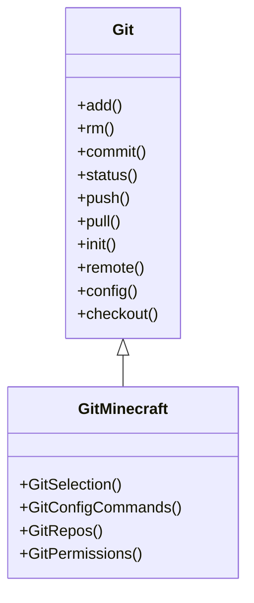

## Overview
This will be a wrapper around git, mainly storing the blockdata in the text format, however we could add compatibility with litematica in the future, So it can be a bit more useful in survival.

For the git plug-in, we should not recreate git, it should be a git wrapper instead. The main use case for us is to help transfer builds between locations and between people. A secondary one is to provide version control and history, so that changes to a build can be reverted and multiple variations of a build can be recorded. A long term use case is to be able to collect build, lore, and lands data for training models to do things such as value lands for war, taxes, or development level. To divide lands into fair districts for geopol games. 

The git plug-in should work like this. For the user they can start a git selection using the same land selection mechanism we have. They right click and left click and block to make a cuboid selection. They will also need to name the selection. This will act as a git add, which they can then commit. The first selected block will count as the starting point, so we can convert the coordinates to relative coordinates based on the starting block.

Deeper into functionality: Since our land selection works like a set of cuboid regions, we can order them based on the smallest absolute corner coordinate, since it is relative that would mean the first coordinate selected will be zero and is the first cuboid. 

Now what happens when we merge commits: the final state of each coordinate will be kept, the overall commit will contain modify data on the entire build, recorded as the set of cuboids over the build, with relative coordinates from the starting corner. Each coordinate recording its blockdata. 

What happens if the player removes some coordinates from the build: This is equivalent to removing/untracking files. For most coordinates this is fine, however there is an edge case regarding the starting coordinate. After a user deletes the starting coordinate, we will have a set of cuboids, with relative coordinates, however none of the cuboids will have a coordinate starting at 0. This isn't a problem, abstractly that 0 coordinate is still represented, since the rest of the blocks in the build refer to it. The software will just handle this by keeping the cuboid regions sorted by smallest corner coordinate. The sorting should happen whenever a region is added or removed. 

Furthermore, there is another edge case. If players keep on removing the smallest coordinates, their actual selection will move farther away from the relative starting point. Now this is unlikely to happen, considering regular player activity, but it could happen if a player is trying to behave maliciously. Though it should not effect the software in any way. We could add a function to readjust the relative coordinates to the current smallest coordinates. In a regular commit this will just record the change in starting coordinate in a meta data field. So when it is locally pulled into a world, the starting point can be shifted before applying changes, so the block changes are not in the wrong spot.

Now we have been discussing about relative coordinates for awhile. But how will we get the relative coordinates and convert them per world? So for converting, it's just math. Basically the starting coordinate subtracted by its self, becomes the new 0,0,0 coordinate. We just subtract the starting coordinate from all other coordinates in the selection. To convert back we do the opposite, just add the starting coordinate back to all the blocks in the selection. This will mean that each local instance will have meta data stored locally, tracking the current starting block for each selection, with its in-game coordinates.

Now what about pulling a build into your world. So if 

- For the Git project how will we represent 3D Block & Entity data as a 2D text file? 
	- One option is to have each line represent an `xz` plane, then the next line iterates on the `y` axis. 
	- Another option is to have multiple files representing on point on the `y` plane each. That would be easier to read I believe. 
- Now how will we represent that actual data though?
	- We could make each line comma seperated, so the commas represent the next coordinate. However if we use our original plan of keeping the lowest coordinate block from the initial commit as the generalized origin for the build. Then we will need to represent both positive and negative coordinates. So the Initial coordinate might get lost in a position. Though, we will have to save that generalized origin in the meta-data, so we could use that to jump to the position we need. Since comma seperate lines are just `.csv` files, we could easily jump to the coordinate of the general origin.
		- For the `csv` files they can easily represent Quadrant 1, the positive coordinate, but if we try to represent multiple quadrants then we wont know what the first line is starting at. We can either save the starting coordinate in the csv file, or have four csv files per plane, one for each quadrant.
	- The relative coordinates being stored as the position in a csv file works, now if there is a lot of space between coordinates it will waste storage space, but we can decide a fix to that later. For the actual Block Data, we will only need to store the block type and any attributes it has such as orientation, being water logged, and any others.
- How will the Git plugin, and later Client side mod, download git bash if it does not exist?
	- Perhaps it will download a portable version of git bash in the mod/plugin location. Therefore allowing us to control what version of git bash the mod/plugin requires.
	- Perhaps there is a git bash Java Library, so we can package it as a dependency in the jar.
- How will we get git in our plugin?
    - There is a Java library for git, called [Jgit](https://git-scm.com/book/pl/v2/Appendix-B:-Embedding-Git-in-your-Applications-JGit) We can add this as a dependency in [gradle](../../build.gradle).

## Data format
We will set the block & entity data as a 3D csv using 4 files per y level, each file representing one quadrant of the plane. But how will we store the corresponding labels?
- From the Building-Lore linking plugin, the overall label is stored as a describer/name over a collection of min-max corners that make up the multi-cuboid region. 
- I believe both of these methods should work, as it might be unnecessary to repeat the describer over every block in its region, rather when comparing the prediction to the truth we will just check what regions the prediction is in and if the describer matches.
- Also for the describer we would need to make sure we have a finite set of labels to make it doable. It might be difficult to create a classifier with infinite labels even though the labels can have the same semantic meaning.

## Commands

### GitSelection()
The command to allow users to use the cuboid land claiming mechanic to create a selection and add it to the repository overall selection.
- Should each repository only have 1 selection?
	- If they have one selection it will basically be like the land claim becomes a single representation in the repo.
		- One representation is good, even if we have a discontinuity the 4 csv per y -level format means we don't need to have massive empty csv files for the blocks in the discontinuity. It would instead jump. 
		- However for large enough discontinuities like perhaps at around 1000 blocks in the xz plane, we should have the selection stored as its own representation, still in the same repository but with its own relative origin.
	- If they have multiple selections then we could have multiple builds having their own representation, but then there might be overlap.
		- We can still represent the overlapping data through the lore-linking plugin combination, where the lore selection can overlap, and since they are stored as cuboid corners the overlap wont use wasted space.
**--init:** this allows a new selection to be initialized, so even if it is less than 1000 blocks away from a previous selection, the player can create a new one. Perhaps to organize the block data between different nearby settlements.
**--add:** To add a new set of blocks to a selection
**--select:** to select which selection in a repository to work with.
**--remove:** to remove a set of blocks from a selection.
**--list:** to show all the selections in the current repository
### GitConfigCommands
The command to enable or disable other git commands, so for example in a survival world you might not want the git pull command to paste in changes. Perhaps later on when it is litematica compatible, a user can pull and see the changes as a litematica schematic render.

### GitPermissions
Similar in use to the [[#GitConfigCommands]], used to control what command certain players or roles can perform, to prevent un intended behavior.

### GitRepo
We would want the player to create multiple repositories, perhaps one repository for each nation or group. Or personal repository to store their builds. This command can visualize what repositories they have and which is currently selected.
**--select:** To select which repository is currently being worked with
**--init:** To create a new repository
**--remove:** To remove a repository, this will not effect the in-game block or lore data however. And can only be done by the owner of the repository.