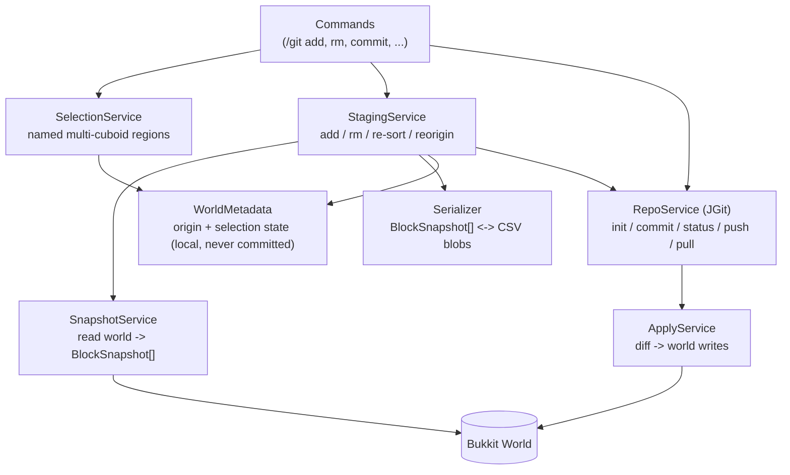
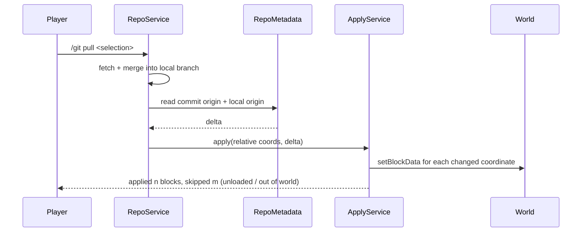

# Git Plugin — Implementation Plan

Derived from [Git Minecraft Plugin Thoughts.md](Git%20Minecraft%20Plugin%20Thoughts.md).
This document turns those thoughts into an ordered build plan: what to build, in what order,
which classes own which responsibility, and which edge cases must be handled before we call a phase done.

## 0. Intent & scope

We are **not** re-implementing Git. We are wrapping it (JGit) so that a Minecraft build region can be
treated like a file tree.

| Priority | Use case |
|---|---|
| Primary | Move builds between locations and between people. |
| Secondary | Version control & history — revert changes, keep multiple variations of a build. |
| Long term | Collect build/lore/lands data as training data for valuation, taxation, development level, and fair district division. |

**In scope (v1):** selection → add/rm → commit → status → push/pull, relative-coordinate storage,
CSV serialization of blocks + block entities.
**Out of scope (v1):** merge conflict resolution, branching UX, Litematica import/export, lore labels, client-side mod.
**Non-goal:** server-side Git hosting. Remotes are user-supplied (file path, HTTP, SSH).

## 1. Guiding principles

1. **Git is the storage engine.** Every design decision should be expressible through JGit's object
   model (blobs, trees, commits, refs). If we can't say it in Git terms, we are over-engineering.
2. **The world is always the source of truth.** A commit captures a snapshot; a pull *applies* a diff.
   Nothing in the working tree remembers state that the world doesn't have.
3. **Main-thread block access only.** All `World#getBlockData` / `setBlockData` calls happen on the
   server thread. Serialization of an already-captured snapshot may be async.
4. **Selections are durable, named, and local.** A selection is a first-class object persisted per-world,
   not an in-memory session.
5. **Relative coordinates are a view, never the truth.** Absolute coordinates live in local metadata;
   relative coordinates live in the repo.

## 2. Architecture overview



### Proposed package layout

```
org/almond/minecraftgit/
├── GitPlugin.java                  # JavaPlugin: wiring, lifecycle, async executor
├── config/
│   └── PluginConfig.java           # repo path, limits, wand item, message strings
├── model/
│   ├── BlockSnapshot.java          # absolute + relative coords, blockdata string, NBT
│   ├── EntitySnapshot.java
│   ├── Cuboid.java                 # min/max corners, ordering key
│   ├── Selection.java              # name, owner, List<Cuboid>, origin, tracked set
│   └── BuildDiff.java              # added / changed / removed coordinates
├── selection/
│   ├── SelectionService.java       # create/get/delete, add/remove cuboid, re-sort, re-origin
│   ├── SelectionListener.java      # left/right click wand handling
│   └── SelectionMetadataStore.java # JSON/YAML under plugin data folder, per world+UUID
├── world/
│   ├── SnapshotService.java        # capture blocks/entities from a Selection
│   └── ApplyService.java           # write a BlockSnapshot[] into a world
├── serialization/
│   ├── QuadrantCsvWriter.java
│   ├── QuadrantCsvReader.java
│   └── SnapshotCodec.java          # blockdata string <-> BlockData, NBT encode/decode
├── repo/
│   ├── RepoService.java            # JGit facade (init/commit/status/push/pull/checkout)
│   ├── RepoLocator.java            # where the .git lives for a given world
│   └── CommitMeta.java             # origin, selection name, dimensions, format version
└── Commands/
    ├── GitCommand.java             # /git root + subcommand dispatch
    ├── GitSelection.java           # /git selection ... (wand, name, list, delete)
    ├── GitCommit.java
    ├── GitStatus.java
    ├── GitRemote.java
    └── ...
```

## 3. Phase plan

Each phase ends with a working, testable increment. Phases 1–3 are the foundation; 4–8 are the
user-visible Git workflow; 9+ is where the long-term goals attach.

### Phase 0 — Bootstrap & de-templating
**Goal:** the plugin actually loads as *our* plugin.

- [ ] Fix `src/main/resources/plugin.yml` → `name: MinecraftGitPlugin`, `main: org.almond.minecraftgit.GitPlugin`, real author/description, `api-version: '1.21'`, `/git` command + `minecraftgit.command.*` permissions.
- [ ] Delete/replace `com/example/minecrafttemplateplugin/TemplatePlugin.java`.
- [ ] `GitPlugin` gains: `PluginConfig`, command registration, a bounded async executor, and a `RepoService` held as a singleton field.
- [ ] Add a `minecraftgit.debug` flag that logs every world read/write to a per-session file (invaluable for coord bugs).
- [ ] Confirm the Shadow JAR bundles JGit and loads on the target Paper version.

**Done when:** `/git` responds with usage text on a clean server.

### Phase 1 — Repo lifecycle
**Goal:** a world can have a Git repository, without any build data yet.

- `RepoService.init(world)` → JGit `Git.init()` at the configured path.
- `RepoLocator` decision — **open question Q1** (see §6). Default assumption: `<plugin data>/repos/<worldName>/`,
  outside the world folder, so server-side world backups don't tangle with `.git`.
- `RepoService.remote(...)`, `RepoService.config(user.name, user.email)` — required before the first commit,
  otherwise JGit refuses to commit.
- `commit()` / `push()` / `pull()` thin wrappers with structured result types (never throw raw JGit exceptions at the command layer).
- Per-world `RepoMetadata` file mapping plugin concepts → Git concepts, e.g. which branch is "the main line".
- All repo I/O runs off the main thread; commands return a `CompletableFuture` and reply to the sender on completion.

**Done when:** `/git init` creates a repo, `/git remote add origin <path>` works, `/git push` pushes an empty commit to a local bare repo.

### Phase 2 — Selection subsystem
**Goal:** the user can define the thing that gets versioned.

- Wand item (configurable, default `WOODEN_SHOVEL`) with left-click = corner A, right-click = corner B → creates a `Cuboid`.
- Selecting again (with a name set) **appends** a new cuboid to the same named selection — the thoughts are explicit that our land selection is a *set* of cuboids, not one box.
- `/git selection create <name>`, `/git selection list`, `/git selection show`, `/git selection delete <name>`.
- Cuboids are kept **sorted by smallest absolute corner coordinate** on every add/remove (see §4, E1).
- Region preview via particles on `show`.
- `SelectionMetadataStore` persists the selection list (name, cuboids, origin, owner) locally per world+player.
  **This file is never committed** — it is machine-local working state.

**Done when:** a player can build a multi-cuboid selection, disconnect, reconnect, and `/git selection show` still renders it correctly.

### Phase 3 — Snapshot & serialization
**Goal:** a selection becomes bytes in a committed blob.

- `SnapshotService.capture(selection)` walks each cuboid on the main thread, producing `BlockSnapshot`s with:
  - absolute coordinates (world space),
  - relative coordinates (absolute − origin),
  - `blockData.getAsString()` (carries block type, facing/orientation, waterlogged, and most states),
  - serialized block-entity NBT where present (chests, signs, banners, spawners…),
  - a stable sort order for reproducible output.
- Entities (item frames, armor stands, paintings, mobs) captured by `EntitySnapshot` — same relative-coordinate treatment.
- **Missing coordinates are meaningful.** "Air is not the same as untracked" — an untracked coordinate produces no line at all; a tracked coordinate that is air produces a line saying air. This distinction is what makes `rm` work.
- Serialization format: **4 CSV files per Y level, one per quadrant** (as decided in the thoughts doc).
  - Path scheme: `<selection>/y_<y>/<quadrant>.csv` where quadrant ∈ `{pp, pn, np, nn}` (sign of x, sign of z).
  - Each line = one `x` row; columns = `z`. Both run from the quadrant boundary toward +∞ / −∞ respectively, so the origin is at the corner shared by all four files.
  - A **header line** records the format version, origin, and the y level, so a reader can jump straight to the origin's file/row/column instead of scanning.
  - Empty runs may later be collapsed with a run-length token (`*N` = N air/absent columns) if size becomes a problem — **defer**, but keep the format versioned so it is a non-breaking change.
- `SnapshotCodec` round-trip: `BlockData` → string → `BlockData` must be lossless; use a registry-safe `createBlockData(String)` and a fallback for unknown/unloaded modded states.
- Unit tests (pure JVM, no server): round-trip a synthetic 3D volume incl. negative coordinates, empty cuboids, and sparse gaps.

**Done when:** capture → write to blob → read back → compare produces a zero diff on a test region.

### Phase 4 — Staging: add / rm
**Goal:** the working tree reflects the player's intent.

- `/git add <selection>` — stages the capture. Staging means: the selection is marked tracked and its snapshot is held/diffed against `HEAD`.
- `/git rm <selection>` — untracks. Per the thoughts: for most coordinates this is trivial; the interesting
  cases are the origin coordinate and successive removals of the smallest coordinates (§4, E2/E3).
- Renumbering is automatic: whenever a cuboid is added or removed, re-sort by smallest corner.
- **Origin re-adjust** (`/git selection reorigin`): rebase all relative coordinates so the smallest live
  coordinate becomes the new `0,0,0`. In a normal commit this is recorded as a metadata field — the new
  absolute origin — so a pull can shift before applying (E4). This is the safety valve that makes malicious
  or accidental origin drift a non-issue.
- Staging state is persisted locally so it survives server restarts.

**Done when:** add → rm → add in a single session produces a consistent tree, including after removing the origin cuboid.

### Phase 5 — Commit
**Goal:** write the change set into Git.

- `BuildDiff` computation: compare staged snapshots against the previous commit's tree for the same selection.
  - **Merge semantics** (from the thoughts): the *final* state of each coordinate wins. The commit records
    modify data for the whole build as the set of cuboids with relative coordinates, each carrying its block data.
  - Removed coordinates become real file/row removals; added ones become insertions.
- `CommitMeta` (in the commit message body, or a `.meta.json` blob) carries:
  - selection name, dimensions, cuboid count,
  - **absolute origin** at commit time,
  - "reorigined: true/false" + previous origin if the origin moved,
  - format version, plugin version, author, world/Gamemode context.
- Commit message default: `<player>: <selection> — <n> blocks changed` with an override flag.
- Never block the server thread: snapshot on main, diff + write off main.

**Done when:** two commits on the same selection, then `git log -p` on the bare repo, shows an intelligible diff.

### Phase 6 — Status
**Goal:** the user can see what would change.

- `/git status` — untracked selections, staged (added/changed/removed coordinate counts), clean vs dirty.
- Cheap path: compare "capture now" vs "last commit" per tracked selection. Expensive on large builds —
  cache the captured snapshot with a TTL and invalidate on `BlockChangeEvent` inside a tracked selection.
- `/git diff <selection>` — summary + optional count of changed coordinates, plus a spot-check sample.

**Done when:** `/git status` on a 3-cuboid selection reports correct add/change/delete counts.

### Phase 7 — Sync: remote / push / pull / fetch
**Goal:** move builds between people and locations.

- `/git remote add|remove|list`, `/git fetch`, `/git push [--force]`, `/git pull`.
- Credentials: v1 supports local paths and anonymous HTTP. SSH requires adding the optional
  `org.eclipse.jgit.ssh.apache` dependency (already commented in `build.gradle`) — track as a follow-up.
- Progress reporting for long operations (JGit `ProgressMonitor` → action-bar/boss-bar).
- Authentication failures surface as actionable chat errors, never stack traces.

**Done when:** a build pushed from world A is cloned/pulled into world B.

### Phase 8 — Apply / pull into a world
**Goal:** the round trip closes.



- Convert relative → absolute by adding the local origin, plus the origin delta from `CommitMeta` (E4).
- **Y-range & world bounds:** Minecraft 1.21 is `-64..319`. Coordinates outside the target world's range are
  reported and skipped, not silently clamped.
- **Chunk loading:** load target chunks (or require them loaded) before writing; do not force-load the
  entire selection and stall the server — batch writes across ticks with a configurable blocks-per-tick budget.
- **Ordering:** removals and placements must be applied in a deterministic order so overlapping
  multi-cuboid selections land in the intended state.
- **Undo:** keep a local "pre-pull" snapshot so `/git pull --abort` / `/git checkout` can restore. Without
  this, a bad pull is unrecoverable and users will not trust the plugin.
- `/git checkout <commit>` — materialize an older commit into the world using the same ApplyService path.

**Done when:** push from world A → pull into world B reproduces the build exactly (verified by re-capture and diff = 0).

### Phase 9 — Long-term / experimental
Only start these once Phases 0–8 are stable.

- **Litematica compatibility:** import/export `.litematic` so builds are useful in survival. Our CSV layer
  becomes one of several `SnapshotCodec` implementations; the interface should be designed with this in mind from Phase 3.
- **Labels / describers:** consume the Building-Lore linking plugin's `describer + min/max cuboid regions`.
  Do **not** repeat a describer on every block. Instead store regions in commit metadata and, at training
  time, resolve a coordinate → region → describer. Constrain to a finite label set so a classifier is feasible
  even when two labels are semantically identical.
- **Training-data export:** a `training-data` command that streams commit history into a dataset
  (build + lore + lands) for valuation/taxation/district-division models.
- **Client-side mod** (mirrors the plugin, downloads a portable Git or uses a Java Git library — the thoughts
  list both options; prefer the pure-Java route so no external binary is required).

## 4. Edge-case register

| # | Case | Handling |
|---|---|---|
| E1 | Cuboid order is load-bearing | Re-sort the cuboid list by smallest absolute corner on every add/remove. Never rely on insertion order. |
| E2 | Player deletes the starting coordinate | The `0,0,0` coordinate is *abstractly* still represented — remaining blocks reference it. Keep the origin where it is; no cuboid is required to contain it. |
| E3 | Player repeatedly deletes smallest coordinates | The selection drifts far from the origin. Harmless for correctness (relative math still works), so allow it — offer reorigin rather than forcing it. |
| E4 | Origin moved between pull and push | Record the new absolute origin in `CommitMeta`; on apply, shift by `localOrigin − commitOrigin` before writing. |
| E5 | Malicious / adversarial selections | Assume hostility for free: cap cuboid count, total volume, and per-commit block count (configurable). Reject selections that exceed them with a clear message. |
| E6 | Coordinate removed vs coordinate set to air | Tracked-and-air emits a line; untracked emits nothing. `rm` removes lines, not blocks. |
| E7 | Sparse / far-apart coordinates in a quadrant CSV | Storage waste is accepted in v1; versioned run-length encoding later (Phase 3 note). |
| E8 | Block entity NBT (chests, signs) | Serialized per block; requires a documented size cap and a truncation warning. |
| E9 | Entities at the selection boundary | Entities are captured by bounding box overlap, not block position — define and document the rule, and apply the same rule on apply. |
| E10 | Unloaded chunks during capture/apply | Snapshot only captures loaded chunks and warns about skipped regions; apply loads/batches explicitly. |
| E11 | Out-of-range Y after an origin shift | Report and skip; never clamp silently. |
| E12 | Two players editing the same selection | Local metadata is per-player; the repo is the merge point. v1 = last commit wins + chat warning. |

## 5. Testing strategy

- **Pure-JVM unit tests** (no server): `Cuboid` ordering, relative/absolute conversion incl. negative
  coordinates, CSV quadrant round-trip, `SnapshotCodec` losslessness, `BuildDiff` merge semantics,
  origin-shift math, E2/E3/E4 scenarios.
- **Mocked-Bukkit tests** for `SnapshotService` / `ApplyService` where practical.
- **Integration, manual on `/run`:** build a known structure, commit, mutate, status, pull back, verify.
  Keep a small "golden save" world for this.
- Every phase boundary needs a dev-log entry; the existing `Utils/dev-log-generator` flow already produces them.

## 6. Open questions

- **Q1 — Where does `.git` live?** Inside the world folder (travels with the map, but bloats world backups
  and risks corruption on save) or in the plugin data folder keyed by world name (cleaner, but the repo is
  no longer self-contained). Current plan assumes the plugin data folder; revisit if portability wins.
- **Q2 — One repo per world or one repo per server?** Per-world matches the `RepoLocator` design; per-server
  makes cross-world builds a `git checkout` away. Per-world is the safer default.
- **Q3 — Quadrant naming and the y-level file layout** are settled, but should a *single* selection ever span
  multiple worlds/dimensions (Nether ↔ Overworld)? If yes, the repo tree needs a dimension dimension.
- **Q4 — How does `GitMinecraft : Git` (from the thoughts' class diagram) map onto our command classes?**
  The diagram implies a shared base with `add/rm/commit/status/push/pull/init/remote/config/checkout`.
  Suggest: an abstract `GitCommandGroup` holding the JGit-facing methods, subclassed by the Minecraft-specific
  command group — worth confirming before Phase 1 so the command layer isn't rewritten later.
- **Q5 — Compression/limits.** Real megabuilds are millions of coordinates. What's the hard volume cap for v1,
  and do we let JGit's own compression handle blob size or pre-pack with gzip?
- **Q6 — Does `checkout` mean "restore world blocks" or "checkout a branch"?** The thoughts list `checkout()`
  as a Git operation; for a Minecraft user the intuitive meaning is "put this build back in my world",
  which is what Phase 8 implements. Confirm the intended semantics.
